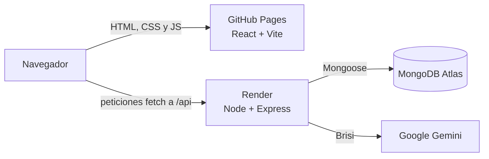

# 🌮 Mexican Club Kitchen

Web de comida mexicana a domicilio en Barranquilla, con carrito de pedidos, panel de administración y **Brisi**, una asistente con inteligencia artificial que recomienda platos y ayuda a armar el pedido.

Proyecto final de **Jóvenes Creativos**.

| | Enlace |
|---|---|
| 🌐 Web | https://jorgevillasotomayor17-dotcom.github.io/mexican-club-kitchen/ |
| 🔐 Panel de administración | https://jorgevillasotomayor17-dotcom.github.io/mexican-club-kitchen/admin.html |
| ⚙️ API | https://mexican-club-kitchen.onrender.com |

> El backend está en el plan gratuito de Render: si nadie lo usa en 15 minutos se duerme, y la primera visita puede tardar unos 50 segundos en responder.

## ✨ Funcionalidades

**Para los clientes**

- **Landing page** con portada, menú, sección "Quiénes somos" y contacto.
- **Catálogo** de platos por categoría (Tacos, Burritos, Quesadillas y Bebidas), leído desde la base de datos.
- **Carrito de pedidos**: agregar platos, cambiar cantidades y enviar el pedido con nombre, teléfono y dirección. Se guarda en el navegador para no perderlo al recargar.
- **Brisi 🤖**: chat con IA (Google Gemini) que conoce el menú y los precios reales, recomienda platos y propone agregarlos al carrito con un botón.
- **Formulario de contacto** que guarda los mensajes en la base de datos.
- **Diseño responsive** con estilo vidrio (*glassmorphism*), animaciones al bajar por la página y soporte para quien prefiere reducir el movimiento.

**Para el administrador**

- Login con correo y contraseña (JWT).
- Crear, editar, ocultar y borrar platos.
- Ver los pedidos y cambiar su estado: pendiente, preparando, en camino, entregado o cancelado.
- Leer los mensajes de contacto y marcarlos como leídos.

## 🏗️ Arquitectura



- El **frontend** es una web estática: GitHub Actions la compila y la publica en GitHub Pages cada vez que cambia algo en `frontend/`.
- El **backend** es una API REST en Render que se vuelve a publicar con cada `git push` a `main`.

## 🧰 Tecnologías

| Parte | Tecnologías |
|---|---|
| Frontend | React 19, Vite, CSS (variables, grid, `backdrop-filter`), Context API |
| Backend | Node.js 22, Express 5, Mongoose, JWT, bcryptjs, express-rate-limit |
| Base de datos | MongoDB Atlas |
| Inteligencia artificial | Google Gemini (`@google/genai`) con salida estructurada en JSON |
| Despliegue | GitHub Pages + GitHub Actions (frontend), Render (backend) |

## 📁 Estructura

```text
mexican-club-kitchen/
├── .github/workflows/      # Publicación automática del frontend
├── backend/
│   ├── config/db.js        # Conexión a MongoDB
│   ├── middleware/auth.js  # Revisa el token del administrador
│   ├── models/             # Plato, Pedido, Mensaje y Admin
│   ├── routes/             # auth, platos, pedidos, mensajes y chat (Brisi)
│   ├── seed.js             # Carga 5 platos de ejemplo
│   ├── crearAdmin.js       # Crea el administrador
│   └── server.js           # Punto de entrada de la API
└── frontend/
    ├── index.html          # Web pública
    ├── admin.html          # Panel de administración
    └── src/
        ├── components/     # Encabezado, Portada, Menu, Carrito, Brisi…
        ├── carrito/        # Estado del carrito compartido con Context
        └── admin/          # Login y gestión de platos, pedidos y mensajes
```

## 🚀 Cómo ejecutarlo en tu computador

**Necesitas:** Node.js 22 o más reciente, una base de datos gratuita en [MongoDB Atlas](https://www.mongodb.com/atlas) y una clave gratuita de [Google AI Studio](https://aistudio.google.com/) para Brisi.

### 1. Backend

```bash
cd backend
npm install
cp .env.example .env    # En Windows PowerShell: copy .env.example .env
```

Llena el archivo `.env` (ver la tabla de abajo) y luego:

```bash
npm run seed          # Carga los platos de ejemplo
npm run crear-admin   # Crea el administrador con los datos ADMIN_* del .env
npm run dev           # Inicia la API en http://localhost:3000
```

### 2. Frontend

En otra terminal:

```bash
cd frontend
npm install
npm run dev           # Abre http://localhost:5173
```

### Variables de entorno del backend (`backend/.env`)

| Variable | Para qué sirve |
|---|---|
| `PORT` | Puerto de la API (por defecto 3000) |
| `FRONTEND_URL` | Dirección del frontend que puede usar la API (CORS) |
| `MONGODB_URI` | Cadena de conexión de MongoDB Atlas |
| `JWT_SECRET` | Clave larga y secreta para firmar los tokens del login |
| `ADMIN_NOMBRE`, `ADMIN_EMAIL`, `ADMIN_PASSWORD` | Datos del administrador que crea `npm run crear-admin` |
| `GEMINI_API_KEY` | Clave de Google AI Studio para Brisi |

El frontend usa `VITE_API_URL` (dirección del backend). Si no existe, usa `http://localhost:3000`.

> ⚠️ El archivo `.env` tiene secretos y **nunca** se sube a GitHub: está en `.gitignore`.

## 🔌 API

| Método | Ruta | Acceso | Qué hace |
|---|---|---|---|
| `POST` | `/api/auth/login` | Público | Inicia sesión y devuelve un token |
| `GET` | `/api/platos` | Público | Platos disponibles |
| `GET` | `/api/platos/todos` | Admin | Todos los platos, incluso los ocultos |
| `POST` | `/api/platos` | Admin | Crear un plato |
| `PUT` / `DELETE` | `/api/platos/:id` | Admin | Editar o borrar un plato |
| `POST` | `/api/pedidos` | Público (5 por hora) | Crear un pedido |
| `GET` | `/api/pedidos` | Admin | Ver los pedidos |
| `PATCH` | `/api/pedidos/:id/estado` | Admin | Cambiar el estado de un pedido |
| `POST` | `/api/mensajes` | Público (5 por hora) | Enviar un mensaje de contacto |
| `GET` | `/api/mensajes` | Admin | Ver los mensajes |
| `PATCH` | `/api/mensajes/:id/leido` | Admin | Marcar un mensaje como leído |
| `POST` | `/api/chat` | Público (20 cada 10 min) | Hablar con Brisi |

Las rutas de administrador necesitan el encabezado `Authorization: Bearer <token>`.

## 🔒 Seguridad

- **Contraseñas cifradas** con bcrypt; nunca se guardan ni se devuelven en texto plano.
- **No hay registro público**: el administrador se crea con un script.
- **Tokens JWT** que vencen en 8 horas.
- **Precios calculados en el servidor**: al crear un pedido, el backend busca los precios en la base de datos y no confía en lo que envía el navegador.
- **Límite de peticiones por IP** en todas las rutas públicas que guardan datos o gastan recursos: pedidos, mensajes de contacto y Brisi.
- **CORS** limitado a la dirección del frontend.
- **La IA solo propone**: el servidor revisa que los platos de Brisi existan, y la persona confirma con un botón antes de que entren al carrito.

## 📸 Créditos

- Fotos de los platos: [Unsplash](https://unsplash.com) (licencia libre).
- Hecho por **Jorge** para Jóvenes Creativos.
